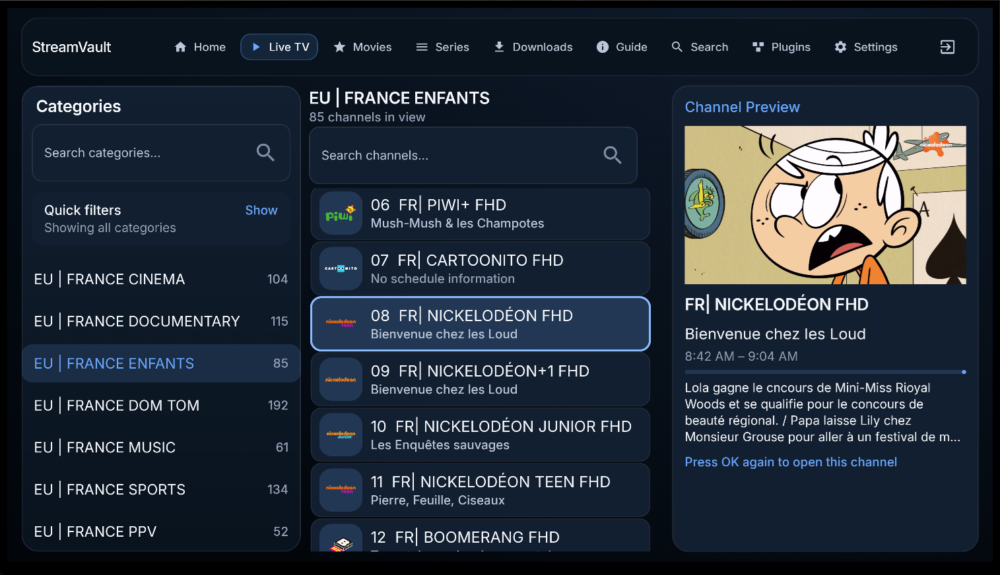
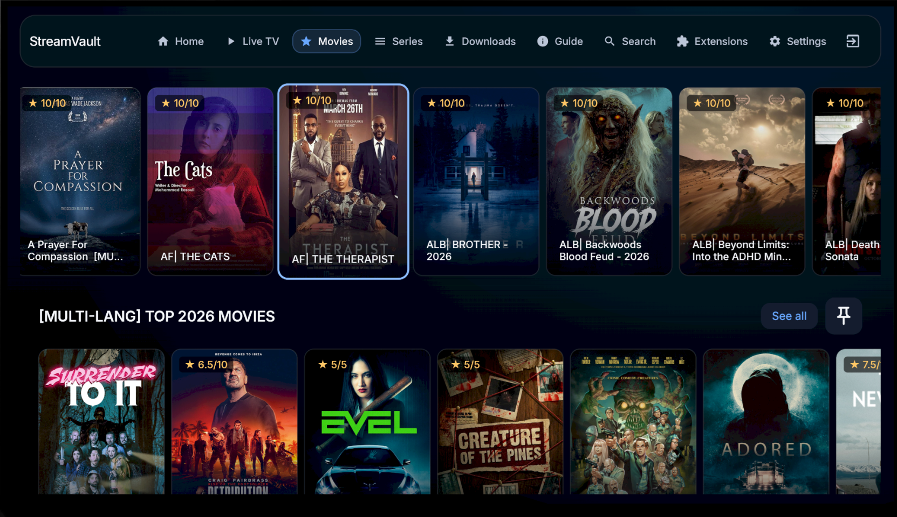
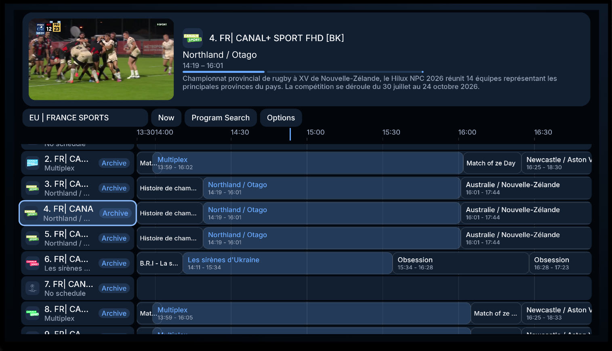
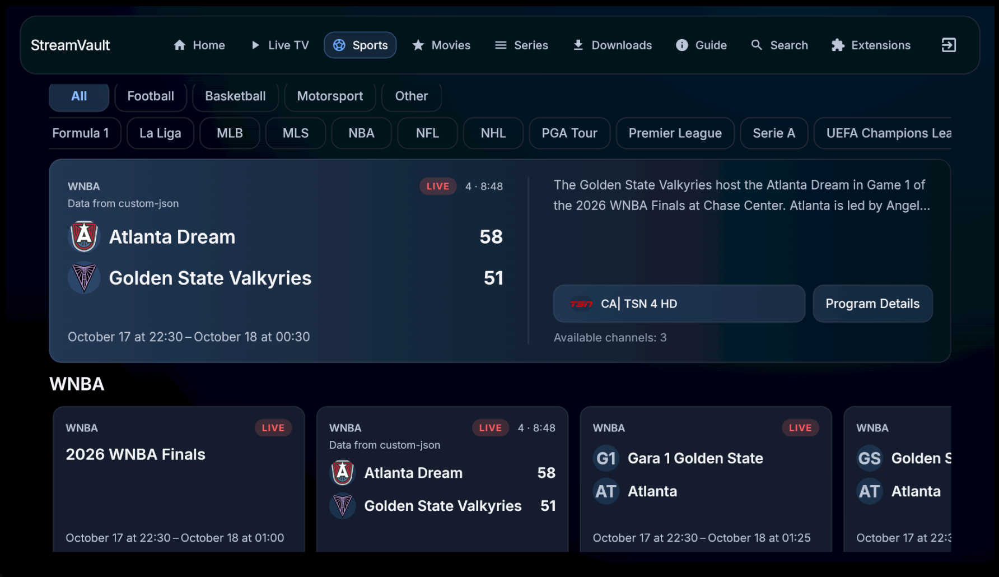

# IMHOSTREAM

IMHOSTREAM is a TV-first IPTV & live TV player for Android and Android TV
(Kotlin, Jetpack Compose, Room, Hilt, Media3).

- **Package:** `com.imhostream.iptv`
- **Download:** see the [download page](index.html) or the
  [latest GitHub release](https://github.com/arjan001/steamixv2/releases/latest)
- **Source:** <https://github.com/arjan001/steamixv2>

## Screenshots

| Live TV | Movies | Guide | Sports |
| --- | --- | --- | --- |
|  |  |  |  |

More screenshots: [Channel View](images/ChannelView.png) ·
[Movie Details](images/MovieInfo.png) · [Series Episodes](images/SeriesEpisodes.png)

## Install

1. Download `IMHOSTREAM.apk` from the latest release.
2. Open the APK on your Android device / Android TV and allow
   "install unknown apps" when prompted.
3. Add your provider (M3U playlist, Xtream Codes, Stalker Portal,
   Jellyfin, or Stremio add-ons) inside the app.

> IMHOSTREAM is an IPTV client, not a content provider. You must supply
your own playlists/providers.
